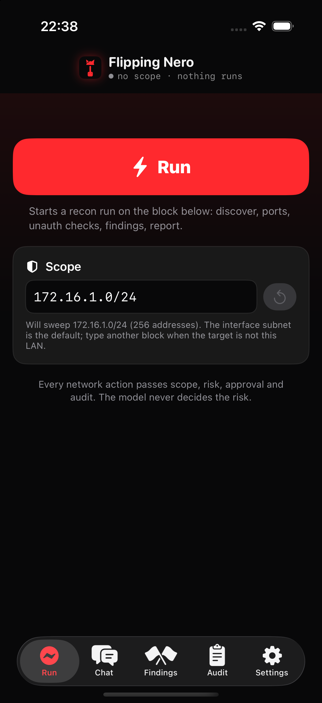
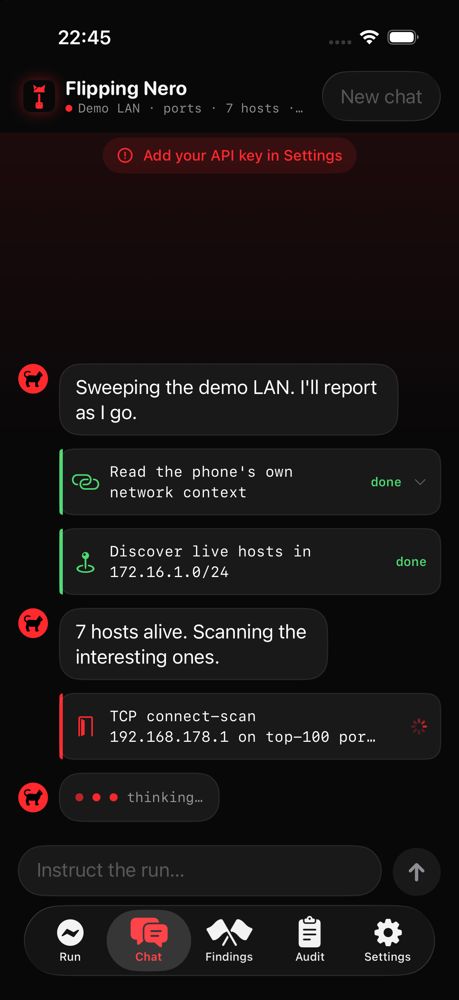
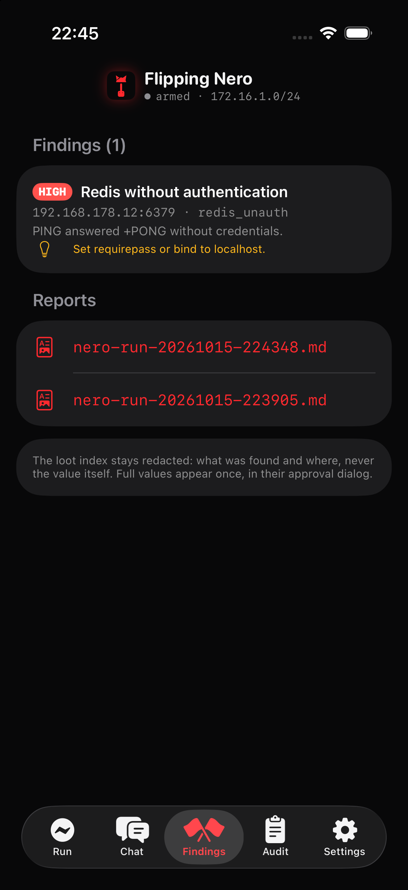
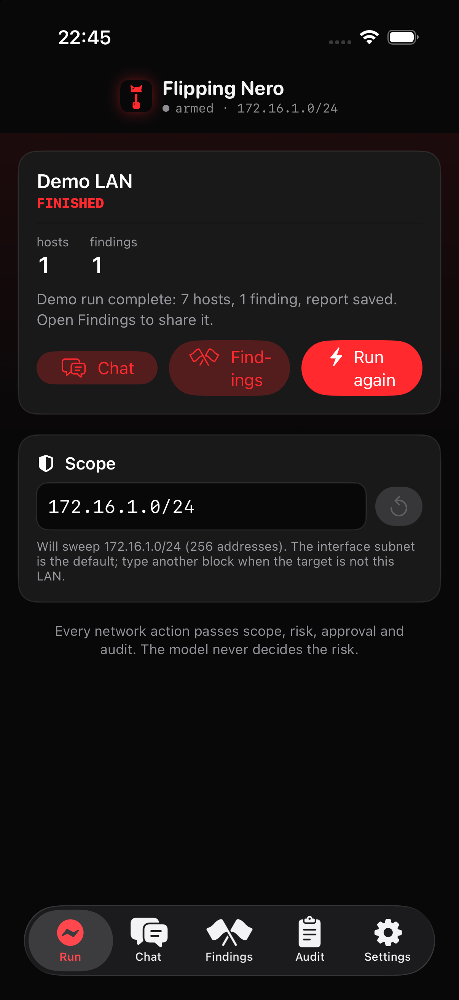

# Flipping Nero — AI-Powered LAN Reconnaissance & Red Team Agent for iPhone

**Flipping Nero** is an iPhone app for **authorized red teaming on your own LAN**: an on-device AI agent that discovers live hosts, scans ports, grabs service banners, checks for unauthenticated services, records findings and writes a shareable report — while every network action passes a code-enforced chain of **scope, risk assessment, approval and audit**. Sideload it, join the Wi-Fi you own, tap **Run**.

> For authorized security testing only — your own networks, or networks you have written permission to test. The German product specification lives in [SPEC.md](SPEC.md).

   

<p align="center">
  
  
  
  
</p>

## What it does

One tap starts a **recon run** on your current subnet (title from the Wi-Fi SSID, scope editable — any `/20` or tighter block). The agent then works autonomously through the tool surface:

| Capability | What runs | Risk |
|---|---|---|
| Network context | own IP, interface, subnet, gateway | low |
| Host discovery | ICMP echo + TCP connect fallback, inside the CIDR only | medium |
| Port scanning | TCP connect scan, `top-100` preset or explicit list | medium |
| Service enumeration | banner grabbing, Bonjour service browsing + TXT records | medium / low |
| HTTP checks | GET/HEAD/POST to in-scope URLs, self-signed certs allowed in scope | medium / high |
| Unauth checks | anonymous FTP, unauthenticated Redis, memcached, MQTT, open admin panels | high, exploit capability |
| Credential spray | one fixed 8-entry bundle against http_basic/Redis, 1 req/s | high, exploit capability |
| Findings & report | structured findings, Markdown + JSON report in the app container | low |

Everything the model reads from the network (banners, HTTP bodies, DNS, mDNS TXT) is fenced as **untrusted data** — planted prompt injections are neutralized and flagged. Secrets found in output are moved to a loot store and only ever appear redacted (`[loot:L1]`); full values reach the iOS Keychain only through an approval you saw them in.

## Why it is different

- **The model never decides the risk.** Risk is computed in code from the parsed, validated tool call — deterministic and model-independent.
- **Without scope, nothing leaves the phone.** Every target passes the `ScopeGuard` (CIDR allowlist, host denylist, port allowlist, time window, hard per-call caps). A `/8` is not a valid argument anywhere.
- **Approvals stay yours.** Low risk runs, medium and high ask (hold-to-confirm for high), blocked is blocked — under YOLO, under engagement, always.
- **Lock Screen first.** Live Activity shows phase, hosts and findings; approvals appear as Allow (Face ID) / Deny right on the Lock Screen with a 60-second timeout.
- **Siri speaks into the same loop.** "Instruct Nero: only 10.0.0.0/24", "Start run", "Stop run" — same session, same policy, same audit log.
- **Pivot relay (meterpreter bridge).** Operator-only: bridge TCP sessions from the LAN to your connect-back handler outside — point `reverse_tcp` payloads at the phone's LAN IP. Peers outside the scope are dropped and audited; the agent cannot open this bridge.
- **Audit-first.** Every tool call lands in an append-only audit log with tool, target, risk and decision (`approved / denied / yolo / engaged / blocked / skipped_needs_foreground`), and the report carries the full timeline.

## Install (sideload, no App Store)

```sh
git clone https://github.com/fbettag/flipping-nero.git
cd flipping-nero
cp Config/Local.xcconfig.example Config/Local.xcconfig   # your team + bundle id prefix
xcodegen generate                                          # brew install xcodegen
open FlippingNero.xcodeproj                                # build & run on your iPhone
```

Requirements: a Mac with **Xcode 26+** (the background-run API is iOS 26; the app runs on iOS 17+), [xcodegen](https://github.com/yonaskolb/XcodeGen), and a free or paid Apple developer account. First run asks for **Local Network** permission (and once for location, which iOS requires to read the Wi-Fi name for the run title). Then add your model provider key in Settings — OpenRouter, Z.ai, Kimi, Qwen, MiniMax, Blackbit, OrcaRouter and 2342.ai are supported, keys stay in the iOS Keychain.

## How the harness works

```
ToolInvocation → ScopeGuard → RiskAssessor → Approval → ToolExecutor → Untrusted.wrap → Audit
```

1. The model's tool call is parsed into a typed enum. Unknown tools and free-form command strings are errors by construction — there is no shell to smuggle into.
2. `ScopeGuard` validates target, port, time window and caps before anything touches the network.
3. `RiskAssessor` classifies the parsed call. The model has no influence on the level.
4. Approval: low runs, medium asks (skippable by setting), high needs hold-to-confirm or a Face-ID Lock Screen button. Permission changes (YOLO, engagement arming, widening the scope) always show a dialog — even under YOLO. In the background they are skipped and audited as `skipped_needs_foreground`.
5. Execution uses iOS-legal primitives only: full TCP connects (`NWConnection`), ICMP via `SOCK_DGRAM`, `dnssd` for DNS/Bonjour, `URLSession` with redirects refused.
6. Everything read from the network is fenced (`<<<NERO_DATA …>>>`), cleaned and injection-checked; reading it taints the turn, so the next offensive action asks again.
7. The audit log records the decision; one run equals one engagement with a Markdown + JSON report you share via the Share Sheet.

iOS limits respected: no raw sockets, no ARP, no SYN scans, no pcap. Multicast beyond declared Bonjour types would need an entitlement the app deliberately does not ship. The full platform notes are in [AGENTS.md](AGENTS.md).

## FAQ

**Is this legal?** Using it against networks you own or are authorized to test (your lab, your company's engagement with written permission) is what it is built for. Attacking networks you have no permission for is illegal basically everywhere. The scope/approval/audit chain exists to keep authorized work disciplined and documented.

**How is this different from running nmap on a laptop?** The phone is the least conspicuous box on the network, the agent chains recon into findings into a report autonomously, and every step is policy-checked and audited — you get an engagement report, not a terminal scrollback. nmap-grade SYN scanning and NSE scripts stay out of v1 by design.

**Does it work in the background?** Yes: with the screen kept awake, or via iOS 26 continued processing when you lock the phone. Approvals surface on the Lock Screen; expiration saves a partial report and pauses the run.

**Which models work?** Any OpenAI-compatible provider with tool calling. The default presets cover eight providers; bring your own key, everything stays in the Keychain.

**Where is the data?** Findings, loot and reports stay in the app container; loot values only move to the Keychain after you approved them. Provider keys never reach the agent or the network.

## Related

- [FlipperHero](https://github.com/fbettag/flipperhero) — the sibling app that puts the same agent harness on a Flipper Zero over Bluetooth.
- The product specification (German) is [SPEC.md](SPEC.md), contributor guide [AGENTS.md](AGENTS.md), security policy in [SECURITY.md](SECURITY.md).

## License

[MIT](LICENSE) © Franz Bettag and Flipping Nero contributors
